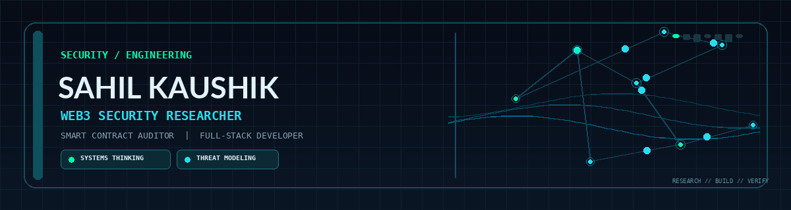
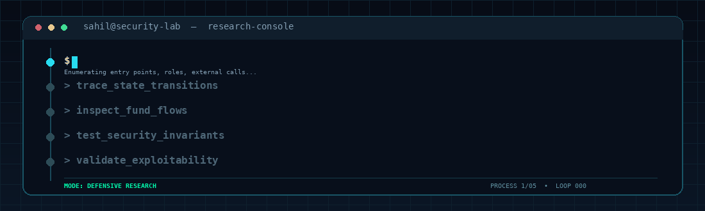
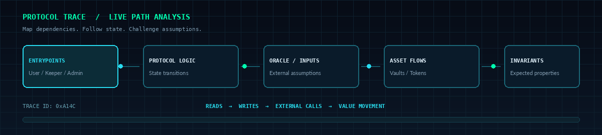
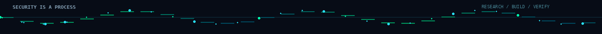

 
  

   

  

    

  
  
  

---

## `$ whoami`

I'm **Sahil Kaushik** — a **Web3 security researcher, smart contract auditor, Web3 developer, and full-stack engineer**.

I work across offensive security and software engineering: reviewing protocol logic, tracing state and asset flows, questioning design assumptions, and building blockchain-connected applications and backend systems.

My approach is to understand a system deeply, map its trust boundaries, test its assumptions, and validate potential vulnerabilities against real execution paths. I enjoy both finding security issues and building software that is easier to reason about, test, and maintain.

---

## `$ focus --areas`

<table>
  <tr>
    <td width="50%" valign="top">
      <h3>01 / Web3 Security</h3>
      

        
        
      

      <ul>
        <li>Smart contract and protocol security reviews</li>
        <li>Bug bounty research and attack-surface mapping</li>
        <li>Access control and state-transition analysis</li>
        <li>Fund-flow tracing and economic attack scenarios</li>
        <li>Fuzzing and invariant-driven testing</li>
        <li>Exploit validation and proof-of-concept development</li>
      </ul>
    </td>
    <td width="50%" valign="top">
      <h3>02 / Software Engineering</h3>
      

        
        
      

      <ul>
        <li>Smart contracts and blockchain integrations</li>
        <li>Backend services and API development</li>
        <li>Full-stack web applications</li>
        <li>Database design and application logic</li>
        <li>Developer tools and test automation</li>
        <li>Debugging and maintainable software architecture</li>
      </ul>
    </td>
  </tr>
</table>

---

## `$ tech_stack`

### Languages & Smart Contracts

  

### Web & Backend

  

### Tools & Environment

---

## `$ security_research_console`

  

<table>
  <tr>
    <td align="center" width="25%">
      <h3>01 / MAP</h3>
      Entrypoints, roles, and trust boundaries
    </td>
    <td align="center" width="25%">
      <h3>02 / TRACE</h3>
      State changes, calls, and asset flows
    </td>
    <td align="center" width="25%">
      <h3>03 / TEST</h3>
      Invariants, edge cases, and assumptions
    </td>
    <td align="center" width="25%">
      <h3>04 / VALIDATE</h3>
      Reproduction, impact, and mitigations
    </td>
  </tr>
</table>

I approach security research by following the complete execution path rather than examining lines of code in isolation. I look at what each function assumes, what state it can change, where value moves, and how components interact under adversarial conditions.

---

## `$ protocol_trace --visualize`

  

My security workflow focuses on understanding the relationships between components, finding broken assumptions, and validating whether a potential issue has a realistic impact.

---

## `$ connect --with=sahil`

  

    Interested in smart contract security, bug bounty research,
    Web3 engineering, and full-stack development.
  

   

  

  

  

    

  

    

  

   

  Research with intent. Build with purpose. Keep questioning.

